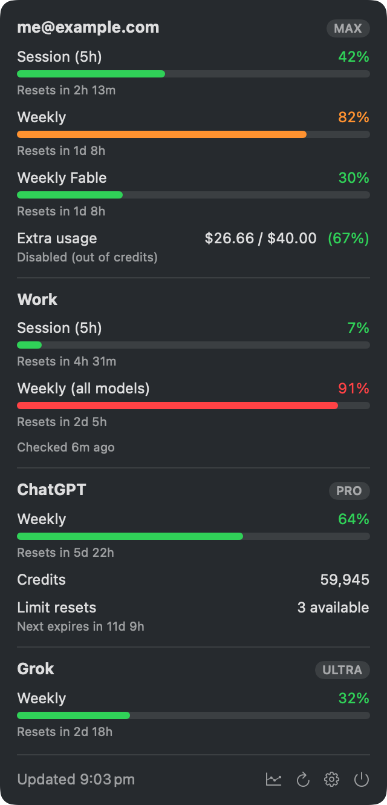
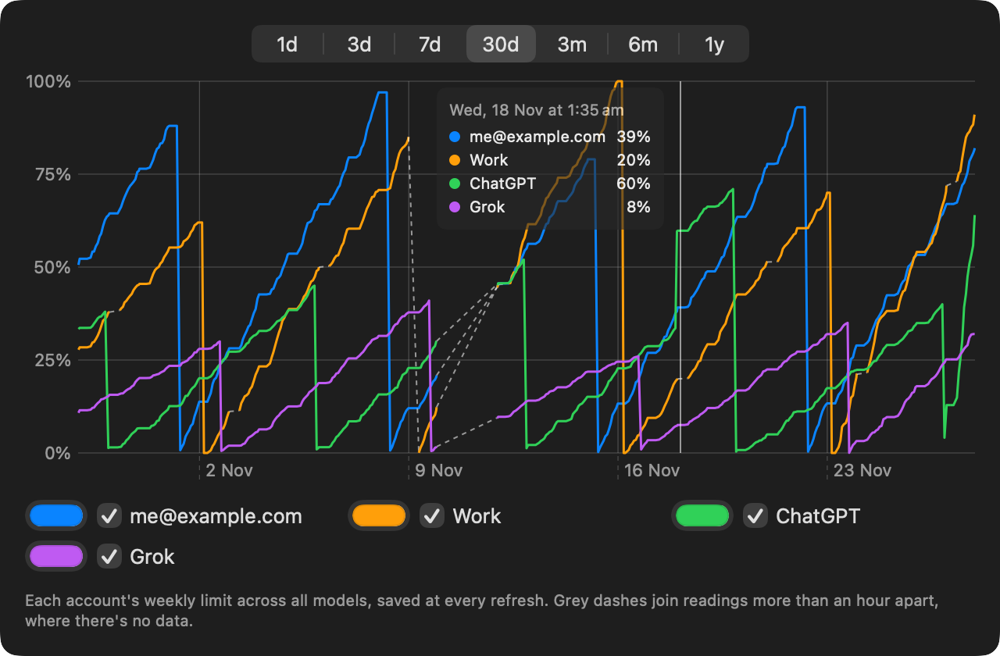

# SubSmasher

Shows plan quota usage for one or more Claude.ai, ChatGPT (Codex) and Grok accounts, either as a command-line tool or as a macOS menu bar app. Both read the same config file. For Claude that's the 5-hour session, weekly and per-model weekly limits plus extra usage; for ChatGPT it's the Codex limits, your credit balance and any limit resets you have available; for Grok it's Grok Bot's weekly usage and any banked resets.

| Path             | What                                               |
| ---------------- | -------------------------------------------------- |
| `cli/`           | `subsmash`, a Bun + commander CLI                  |
| `macos/`         | SubSmasher, a SwiftUI menu bar app (Swift package) |
| `config.example` | Sample config for both                             |

<p align="center">
  
</p>

## Config

The config is an INI file in the style of `~/.aws/credentials`, at `~/.config/subsmasher/config` by default (override with `SUBSMASHER_CONFIG`, or `-c` for the CLI). If that doesn't exist but `~/.config/agent-usage/config` does, from when this was called agent-account-usage, that's read instead. See [`config.example`](config.example).

```ini
[default]
name = "me@example.com"
claude_config_dir = ~/.claude

[personal]
claude_config_dir = ~/.claude-personal

[work]
name = "Work"
setup_token = sk-ant-oat01-...

[chatgpt]
name = "ChatGPT"
codex_home = ~/.codex

[grok]
name = "Grok"
cursor_dir = ~/Library/Application Support/Cursor
```

Each section needs one of:

- `claude_config_dir`: a Claude Code config directory (what you'd pass as `CLAUDE_CONFIG_DIR`). The OAuth token Claude Code stored for it is read from the macOS keychain, or from `<dir>/.credentials.json` on other platforms. Log in once with `CLAUDE_CONFIG_DIR=<dir> claude /login`. Its plan is shown too, with Max 20x as Ultra, its name since Anthropic renamed it.
- `setup_token`: a token printed by `claude setup-token`, run while that account is signed in to claude.ai in your browser. It lasts a year and nothing refreshes it, so it can't be signed out by Claude Code or by these tools. Its usage is read differently (see below). Takes precedence over `oauth_token` and `claude_config_dir`.
- `oauth_token`: a literal Claude OAuth access token from a full login. Takes precedence over `claude_config_dir` if both are set. A `claude setup-token` token looks the same but goes in `setup_token`, as it can't read the usage endpoint.
- `codex_home`: a Codex home directory (what you'd pass as `CODEX_HOME`, `~/.codex` by default). The ChatGPT desktop app and the `codex` CLI both keep your ChatGPT login in `<dir>/auth.json`, and that's read. Sign in with either one first. A Codex signed in with an API key has no plan limits to show.
- `cursor_dir`: Cursor's data directory (`~/Library/Application Support/Cursor` on macOS). Grok Bot is a Cursor app that signs in with a Cursor account, so this shows Grok Bot's usage for the account signed in to Cursor. Grok Bot keeps its own login somewhere it can't be read, so Cursor needs to be signed in to the same account. Cursor encrypts its saved login with a key in the macOS keychain, so the first read makes macOS ask to let `security` access "Cursor Safe Storage". Choose Always Allow or it will ask on every refresh. That also lets any other program that runs `security` read the key.

An optional `name` is shown instead of the profile id (the CLI's `--json` stays keyed by profile id). An optional `claude_path` says where `claude` is, for refreshing that profile's token (see below). An optional `probe_model` is a comma-separated list of models for a `setup_token` profile's check to try in turn. Values may be wrapped in `"` or `'` quotes.

Tokens are only read: neither tool calls the OAuth refresh endpoint or writes a login, so neither can log Claude Code or Codex out. Claude Code access tokens expire after a few hours. When one has, both tools get Claude Code to refresh it by running `claude -p /cost` with that config dir (and with `CLAUDE_CONFIG_DIR` unset for a `~/.claude` login, which Claude Code keeps under a different keychain name). They run it from a temp directory, without loading project settings or MCP servers and without saving the session, then read the token again. `/cost` runs locally, so this doesn't call the model or use any quota. It takes a few seconds. `claude` is looked for on your PATH, then in `~/.local/bin`, `~/.claude/local`, `/opt/homebrew/bin` and `/usr/local/bin` (an app opened from Finder gets a minimal PATH). If refreshing fails, the app tries again after half an hour (straight away if you change `claude_path`); if the sign-in itself has ended, run `claude` yourself the same way. ChatGPT tokens last about 10 days and Codex refreshes them as you use it. Cursor's are long-lived and Cursor refreshes them.

Claude usage comes from `GET https://api.anthropic.com/api/oauth/usage`, the same endpoint Claude Code's `/usage` uses. A setup token can only send messages, so that endpoint refuses it. For a `setup_token` profile, both tools send a one-character message with `max_tokens: 1` to `POST https://api.anthropic.com/v1/messages` instead, and read the `anthropic-ratelimit-unified-*` headers of the response. The message goes to `claude-haiku-4-5-20251001`, or `claude-haiku-5-5` if the plan lacks that, unless you set `probe_model`. The headers give the 5-hour session, the weekly limit across all models, and whether the account is limited or on extra usage. They don't give the per-model weekly limits, the plan or extra usage amounts. Each check spends a few tokens of the plan, and one sent while no 5-hour session is running probably starts one. Anthropic's terms don't sanction using a subscription token outside its own apps, so this is at your own risk. ChatGPT usage comes from `GET https://chatgpt.com/backend-api/wham/usage` (and `/wham/rate-limit-reset-credits` for when your resets expire), which is what Codex uses. Grok usage comes from Cursor's `https://api2.cursor.sh/aiserver.v1.DashboardService/GetSandUsageStatus` (and `ListSandBankedResets`), which is what Grok Bot uses. All of them are undocumented and may change.

## CLI


Credits are what Codex spends once you hit a plan limit. Limit resets are one-off full resets you can use from the ChatGPT usage page; the soonest expiry is shown because they expire.

### Install

```sh
cd cli
bun install
bun link   # puts `subsmash` on your PATH
```

### Usage

```
subsmash                      # the [default] profile, or $SUBSMASHER_PROFILE
subsmash -p work -p personal  # specific profiles
subsmash -a                   # every profile
subsmash --json               # raw API responses keyed by profile ({usage, reset_credits} for ChatGPT, {usage, banked_resets} for Grok, {model, status, headers} for a setup token)
subsmash list                 # profile names and credential source
```

Output is coloured when stdout is a terminal. Set `NO_COLOR=1` to turn colours off, or `FORCE_COLOR=1` to keep them when piping.

The exit code is 1 if any profile failed (missing section, no login, expired token, HTTP error).

### Development

```sh
cd cli
bun test
bun check   # type check
bun fmt     # format
```

## macOS app

A menu bar item showing the app's plush toy hugging a gauge, next to the highest utilization of the profile at the top of the list. The gauge's needle points at that utilization. The icon is the menu bar's usual colour while there's plenty left, then turns yellow at 60%, orange at 70% and red at 90%, the points where the menu's bars turn orange and red. A warning triangle replaces it when the config can't be read or that profile has no usage to show. Click it to see every profile's limits, reset times, extra usage, ChatGPT credits and limit resets, and errors. Drag a profile up or down to reorder them (moving one to the top changes what the menu bar shows); the app remembers the order, while the CLI keeps config file order. It refreshes every 5 minutes, and when opened if the data is more than a minute old. A `setup_token` profile is checked less often, as each check spends a little of the plan: at most every 10 minutes, or once a minute when you open the menu. Once its 5-hour session has ended it isn't checked again until you press refresh, even after a relaunch, so the app doesn't start a new session for you, and the menu says how old its values are. After an error it backs off and keeps showing the last values. After an expired token or a refused request, it waits for you to press refresh. The gear button opens the config in your default text editor, creating a starter file if there isn't one.

The chart button opens Usage History: one graph of every profile's weekly limit (across all models) over the last day, 3 days, week, 30 days, 3 or 6 months, or year. It starts on 7 days and remembers whichever you pick. None of the APIs give past usage, so the app saves each profile's at every refresh, in `~/Library/Application Support/SubSmasher/history.json`, and the graph fills in from when you start running it. It keeps a year: every reading from the last week, and one an hour before that. Grey dashes join readings more than an hour apart, such as while the Mac was asleep or a setup-token profile wasn't checked. The 3-month and 6-month views only mark gaps of more than 12 hours, and the 1-year view more than a day, so nights the Mac slept don't break up their lines. Hover over the graph to read every profile's usage at that time. Untick a profile to hide its line, or click its colour to change it. The app remembers both.

<p align="center">
  <picture>
    <source media="(prefers-color-scheme: light)" srcset="docs/history-light.png">
    
  </picture>
</p>

Needs macOS 14 or later and the Swift 6 toolchain that comes with Xcode.

### Build and install

```sh
cd macos
./scripts/build-app.sh        # builds build/SubSmasher.app (ad-hoc signed)
open build/SubSmasher.app
```

To keep it, copy `build/SubSmasher.app` to `/Applications` and add it under System Settings > General > Login Items. If you had it as Agent Usage, delete `AgentUsage.app` (and its login item). SubSmasher takes over its saved order, setup-token check state and menu bar position the first time it opens.

### Development

```sh
cd macos
swift run SubSmasher                               # run without bundling
swift test
SUBSMASHER_LIVE_TEST=1 swift test --filter live    # also hits the real API with your config
./scripts/screenshots.sh                           # re-renders the README's screenshots in docs/ from sample accounts
```

Open `macos/Package.swift` in Xcode to work on it there. `SubSmasherCore` holds the config, credential and API code (Codex in `Codex.swift`, Grok in `Grok.swift`, setup tokens in `SetupToken.swift`, usage history in `History.swift`), and `SubSmasher` holds the SwiftUI app. `Resources/AppIcon.png` is the app icon, which `build-app.sh` turns into the bundle's `.icns`.
